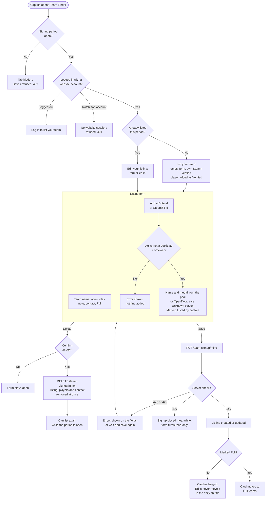

# Pre-Season Team Signup

Before a season, partial teams find each other in a **Team Finder** tab. Captains list their team with the Dota ids of their players, the roles they still need and a contact. Everyone can browse the listings, and the tournament organiser downloads them as a CSV. Issue #220, milestone S17 (implemented). Plan: `markdown/plans/plan-issue-220-pre-season-team-signup.md`.

---

## Signup period

An admin opens a period in Admin › Settings › Season › Team signup. A period has a label (for example "Season 17") and an optional closing time, and the admin can close it early. One period is open at a time. While it is open, `GET /config` returns `team_signup_open: true` and the tab shows. Admins see the tab at any time. The signup doesn't depend on the season's teams, leagues or weeks, so a season Reset leaves it intact.

## Listings

- **Who:** a logged-in website account can list one team per period, and becomes its captain. A Twitch soft account never has a website session (`deps._session_user` ignores it), so its requests answer `401`; `team_signup.save_listing` also refuses one with `403` as a defensive check.
- **Fields:**
  - team name (2–32 characters, cleaned, no links);
  - 1–7 Dota ids, as a 32-bit id or a Steam64 id;
  - open roles (positions 1–5);
  - a note (up to 280 characters, no links);
  - a required contact (up to 100 characters);
  - **Full**.
- **Player names and medals** come from the player pool or OpenDota (looked up by the form before saving) and are stored with the listing. Saving never calls OpenDota: ids not in the pool or the lookup cache are stored as "Unknown player".
- **OpenDota budget:** captains share the server's OpenDota capacity with ingest, so their lookups are capped: 20 uncached ids per user and 60 in total per rolling hour (`player_lookup.CAPTAIN_USER_PER_HOUR`, `CAPTAIN_TOTAL_PER_HOUR`), one call per id with no retries and a 4 s timeout, and never a wait for the shared rate window (`opendota_client.try_throttle`). Over a cap, with the window full or after a failed call, the id comes back as "Unknown player" at once and isn't cached, so it can be looked up later. After one failed or refused call, the remaining ids in that request skip OpenDota too. Personanames are cleaned (`clean_display_text`, 64 characters) before caching.
- **Typed ids are claims:** they don't link accounts. Rows show **Verified** only for the captain's own Steam-verified player (`player_links.verified_player_id`: a `player_id` with the `steam_id` that set it). The captain's verified player is always first, counts towards the 7, and can't be removed from the form.
- **Removing yourself:** a user whose Steam-verified player is listed on another team can remove themselves (**Not on this team**). The row is deleted, the listing's `updated_at` doesn't change, and the audit row `team_signup_not_on_team` names the user; the captain's view never does. Allowed while the listing exists, also after the period closes.

## Captain flow

How a captain creates, updates and deletes a listing. Outside this flow, a listed player can remove themselves (**Not on this team**) and an admin can remove a listing. The same diagram is drawn in the design canvas.

## Browsing

- **Order:** partial teams are shuffled in an order that changes once a day, and editing a listing doesn't move it up. Full teams are in a collapsed section at the end.
- **Filters:** players needed, open role and medal range.
- **Contacts:** shown only to logged-in users.
- **Duplicates:** a player listed by more than one team is flagged.

**Layout:** a card grid, one same-size card per team, in the daily shuffle order (chosen from the design canvas, `design/ui_kits/fantasy_web/team-finder.html`, option A). Each card shows players needed as its large number, the open roles, one row per player and per open slot, the note and the contact.

## Organiser export and retention

- **Admin list:** admins see every listing of the open period (or, with none open, the last one) and can remove one.
- **CSV:** one row per player, with formula-like cells prefixed with `'`.
- **Retention:** 60 days after a period closes, the daily cleanup deletes the period row with its listings and players. **Clear signups** deletes a period's listings and players at once and keeps the period row. Opening, closing, removing and clearing are audited.

## Endpoints

### `GET /team-signup`
Public, 60/minute per IP. `{period, open, logged_in, can_list, teams, full_teams, mine, own_player}`: `teams` are the open period's partial listings in the daily shuffle, `full_teams` the full ones by name. Each listing: `id, team_name, open_roles, note, is_full, player_count, players_needed, updated_at, is_mine, players[]` (`account_id, name, rank_tier, leaderboard_rank, medal, verified, also_listed, is_you`), plus `contact` only for a logged-in viewer. `own_player` is the viewer's Steam-verified player (pool or stored name, never an OpenDota call). Without an open period `period` is the last one (`open: false`) and the lists are empty. Never user ids, usernames or emails.

### `GET /team-signup/lookup?ids=…`
Login required, only while a period is open (`409` otherwise), 30/minute per user. Up to 8 ids separated by commas or spaces (32-bit or Steam64, converted). Pool and cache first, then OpenDota within the captain budget above. Returns `[{account_id, name, rank_tier, leaderboard_rank, medal, source}]` in order; `source` is `pool`, `opendota` or `null` (name `null`: "Unknown player"). OpenDota answers are cached ten minutes (`player_lookup`, shared with Admin › Player Management).

### `PUT /team-signup/mine`
Login required, 10/minute per user. Body `{team_name, players[], open_roles[], note, contact, is_full}`; `players` are typed ids (numbers or digit strings) other than the captain's own verified player, which is added first. Returns the listing as in `GET /team-signup`. Names and medals come from the stored listing, the pool or the lookup cache, never a new OpenDota call. `422` for a field outside its limits, a link in the name or note, a duplicate, zero or more than 7 players, or an id that is neither a Dota id nor a Steam64 id; `409` when no period is open, or "Your listing was saved meanwhile" when two saves race.

### `DELETE /team-signup/mine`
Login required, 10/minute per user. Deletes the listing, its players and contact at once. `404` without a listing, `409` when no period is open.

### `POST /team-signup/{id}/not-on-team`
Login required, 10/minute per user. `404` for a missing listing; `403` for the caller's own listing or when the caller's Steam-verified player is not on it.

### `GET /admin/team-signup`
Admin. `{open, current, periods[] (with listing_count), listings[]}`; listings of the open (else last) period with `team_name, captain` (username), `contact, is_full, player_count, duplicates, updated_at`.

### `POST /admin/team-signup/period`
Admin. `{label (1-40), closes_at? (Unix seconds, in the future)}`. `422` for a closing time not in the future; `409` while a period is open. Audited `admin_team_signup_opened`.

### `POST /admin/team-signup/period/close`
Admin. `409` when none is open. Audited `admin_team_signup_closed`.

### `DELETE /admin/team-signup/{id}`
Admin. `404` for a missing listing. Audited `admin_team_signup_removed` with the period label and team name.

### `GET /admin/team-signup/export.csv`
Admin, `?period_id=` optional (default: the open period, else the last); `404` for an unknown period. Columns: period, team, captain username, contact, full, open roles, note, Dota id, name, medal, verified, also on another team, updated at; one row per player. Cells starting with `=`, `+`, `-`, `@`, tab or CR get a leading `'`. `GET /admin/team-signup/export.json` returns the same rows as `{columns, period, rows}`.

### `POST /admin/team-signup/clear`
Admin with a recent re-authentication (`403 reauth_required` otherwise). `{period_id}`; deletes its listings and players, keeps the period row. `404` for an unknown period. Audited `admin_team_signup_cleared`.

## Data

New tables, no migration: `team_signup_periods` (at most one with `closed_at` NULL, a partial unique index on `COALESCE(closed_at, 0)`), `team_signups` (one per captain per period) and `team_signup_players` (one per listed Dota id, with the name and medal stored at save time). No foreign keys to `teams` or `players`, so a season Reset leaves them.

## Implementation

- `backend/team_signup.py`: periods (the lazy close: a period past `closes_at` is closed for every check; `close_expired` records it before a new period opens and in the cleanup), listing validation and saving, the daily shuffle (`sha256(period id | UTC date | listing id)`, so edits never move a listing and a new listing doesn't reorder the others), the views, the CSV and the retention cleanup. Pass `now=` to make time explicit.
- `backend/player_lookup.py`: typed-id parsing (32-bit or Steam64), the pool / OpenDota name and medal lookup and its bounded ten-minute cache, shared with `routers/admin_players.py`. The admin lookup keeps its response shape and blocking retries; its OpenDota names are now cleaned and capped at 64 characters too.
- `backend/routers/team_signup.py` and `backend/routers/admin_team_signup.py`: thin routes. `main.py` mounts both, adds `team_signup_open` to `GET /config`, and runs `_run_team_signup_cleanup` once a day in the week maintenance loop (best effort; a failure is logged and rolled back).
- Frontend: `frontend/app-team-finder.js` (tab, filters, cards, form), the Team signup card in `frontend/app-admin-season.js`, `.tf-*` rules in `frontend/style.css`. Specs: `markdown/ui_description/team-finder.md`, `admin.md`.
- Limits are module constants: name 2–32, note 280, contact 100, label 40, 7 players, 60-day retention (`team_signup.RETENTION_DAYS`), and the route rate limits in `routers/team_signup.py`.
- Tests: `backend/tests/test_issue_220_pre_season_team_signup.py`.
